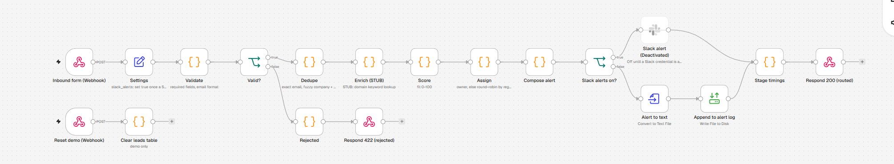
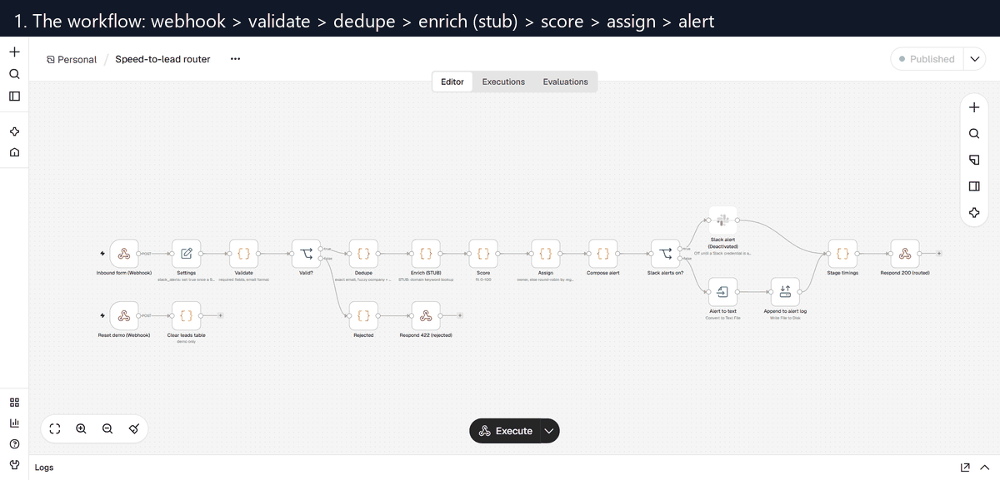

# n8n speed-to-lead router

**Inbound lead to an owner in about 160 ms (median of 20 replayed leads), built in n8n with no app server of my own.**

A web form posts a lead to an n8n webhook. The workflow validates it, checks it against a leads
table, enriches it, scores it, picks a rep and sends the alert, then answers the form with the
assigned rep and the time each stage took. For comparison, the median wait for a first human
reply in the [Revenue Leak Engine](https://github.com/RynoJor/revenue-leak-engine) sample data
is 13 minutes.

This is the router module of the Revenue Leak Engine, rebuilt as an n8n workflow. The Python
version routes the same kind of lead in about 8 ms. The comparison further down says when I would
pick each.

All data here is synthetic.





## Results

`python replay.py` posts the 20 leads in [`sample-leads.json`](sample-leads.json) to the
webhook one at a time:

| | |
|---|---|
| Leads | 20 |
| Routed | 18 |
| Rejected (missing or malformed email) | 2 |
| Dedupe hits (sent to the existing owner) | 6 |
| End to end, HTTP POST to response, median | 163 ms (max 196 ms) |
| Inside n8n, routed leads, median | 113 ms |

Median ms per stage: validate 14, dedupe 18, enrich 12, score 12, assign 12, alert 42.5.
Each stage time runs from the end of the previous stage to the end of this one, so it includes
n8n's hand-off between nodes. Most of each figure is that hand-off: a Code node runs in n8n's
separate task-runner process, which costs roughly 10 to 15 ms per node on this laptop. The
JavaScript inside each node takes well under 1 ms. The Code node sandbox has no high-resolution
timer, so stamps use `Date.now()` and are whole milliseconds.

Per-lead rows are in [`output/replay-log.csv`](output/replay-log.csv) and the summary is in
[`output/replay-summary.json`](output/replay-summary.json). Timings are wall clock and move a
little from run to run.

What the sample shows, lead by lead:

- S02, S06, S10, S14, S18: R01 is at capacity, so North America round-robin skips to R02.
- S04 (same email, different case) and S13 (same person again): `duplicate_contact`, sent to the owner.
- S05 "Riverlight Clinik": a fuzzy company match plus the same email domain, so `known_account`.
- S06 "Silverlight Clinic": the name is close to "Riverlight Clinic" but nothing else agrees, so it
  is treated as a new business. Name similarity alone is not enough.
- S11 "Brightpath Tutoring Ltd": exact company match once the legal suffix is dropped.
- S12: APAC's only rep is full, so the least-loaded rep takes it and the lead is flagged `over_capacity`.
- S07 (no email) and S08 (`tom@@harborlights`): rejected with HTTP 422.

## The workflow, node by node

| # | Node | Type | What it does |
|---|---|---|---|
| 1 | Inbound form (Webhook) | Webhook | `POST /webhook/speed-to-lead`. The response waits for a Respond node |
| 2 | Settings | Edit Fields (Set) | Start time stamp, rep capacity (12 open leads), Slack on/off, alert log path |
| 3 | Validate | Code | Requires `company`, `contact_name`, `email`, `region`, `source`. A missing or malformed email rejects the lead; any other gap is flagged and routing carries on |
| 4 | Valid? | If | Rejected leads go to 5, the rest to 7 |
| 5 | Rejected | Code | Builds the rejection with its flags and timing |
| 6 | Respond 422 (rejected) | Respond to Webhook | Returns the rejection to the form |
| 7 | Dedupe | Code | Checks the leads table. Exact email (case-insensitive) is `duplicate_contact`. A company name match after normalising (case, punctuation, legal suffixes) is `known_account`. A fuzzy name match (similarity of 0.85 or more) also needs a second signal: the same contact surname or the same business email domain. Gmail-style domains never count |
| 8 | Enrich (STUB) | Code | **Stub.** Fills a missing industry from words in the email domain and a missing size band from a hash of the domain. Public mail domains are skipped and flagged |
| 9 | Score | Code | Fit score 0 to 100: source intent, company size, core industry, business email. Same points as the Python router |
| 10 | Assign | Code | A dedupe hit goes to the rep who already owns the person or account. Otherwise round-robin within the region, skipping reps at capacity. A full region goes to the least-loaded rep (`over_capacity`); an unknown region uses all reps (`unknown_region`). Adds the lead to the leads table |
| 11 | Compose alert | Code | The alert text, same wording as the Python router |
| 12 | Slack alerts on? | If | Reads `slack_alerts` from Settings |
| 13 | Slack alert | Slack | Posts the alert to `#inbound-leads`. Off by default (see below) |
| 14 | Alert to text | Convert to File | Turns the alert into a text file item |
| 15 | Append to alert log | Read/Write Files from Disk | Appends to `output/alerts.log` |
| 16 | Stage timings | Code | Turns the time stamps into ms per stage and builds the response |
| 17 | Respond 200 (routed) | Respond to Webhook | Returns the assigned rep, the reason, the score, flags and ms per stage |
| 18 | Reset demo (Webhook) | Webhook | `POST /webhook/speed-to-lead-reset`, used by `replay.py` |
| 19 | Clear leads table | Code | Clears the leads table, rep loads and rotation so a replay starts from the seed. Demo only |

### Where the state lives

The leads table, each rep's open-lead count and the round-robin position are kept in the
workflow's static data (`$getWorkflowStaticData('global')`). n8n saves it after every production
execution, so it carries over from one lead to the next with no database or spreadsheet to set
up. The first run seeds it with 8 existing leads and the reps' starting loads, both written out at
the top of the Dedupe and Assign nodes. Static data is only saved for production executions (a
published workflow called on `/webhook/`), not for test runs from the editor.

An n8n Data Table would be the next step: the leads would be visible and editable in the n8n UI.
I used static data so the workflow imports and runs with no tables to create first.

### Example response

```json
{
  "lead_id": "S02",
  "status": "routed",
  "assigned_rep": "R02",
  "rep_name": "Joshua Walker",
  "assign_reason": "round_robin (skipped 1 at capacity)",
  "score": 95,
  "dedupe_hit": false,
  "flags": ["alert_logged"],
  "enriched_fields": {"industry": "Health & Wellness", "company_size": "51-200"},
  "stage_ms": {"validate": 17, "dedupe": 20, "enrich": 14, "score": 13, "assign": 14, "alert": 46},
  "total_ms": 124
}
```

## Import and run it

You need Node.js 20 or later (tested on Node 24 with n8n 2.46.7) and Python 3 for the replay.

1. Start n8n locally. Its data goes to `.n8n-data/`, which is git-ignored:

   ```bash
   ./start-n8n.sh
   ```

   On Windows, run it from Git Bash. The first run downloads n8n through `npx`, which takes a few
   minutes. Open http://localhost:5678 and create the local owner account it asks for.

2. Import the workflow: **Create workflow → ⋯ → Import from File →
   `workflows/speed-to-lead.json`**, then **Publish** it. Publishing switches on the production
   webhooks.

3. Replay the sample leads:

   ```bash
   python replay.py
   ```

   This resets the demo state, posts the 20 leads, prints each route, and writes
   `output/replay-log.csv` and `output/replay-summary.json`. Alerts go to `output/alerts.log`.

4. Send one lead yourself:

   ```bash
   curl -X POST http://localhost:5678/webhook/speed-to-lead -H "Content-Type: application/json" -d '{"company":"Quillbrook Pilates Studio","contact_name":"Avery Example","email":"avery@quillbrookpilates.example","region":"EMEA","source":"demo_request"}'
   ```

The alert log path is relative to the folder n8n was started from. `start-n8n.sh` limits n8n's
file access to `output/`, so that is the only place the workflow can write.

### Turning on Slack

n8n's Slack node signs in with a Slack app's bot token, not an incoming-webhook URL. The token is
stored in n8n's encrypted credential store, never in the workflow file.

1. In n8n, create a **Slack API** credential with your bot token.
2. Open the **Slack alert** node, pick that credential and the channel, and switch the node on
   (it ships deactivated so the workflow can be published without Slack).
3. In **Settings**, set `slack_alerts` to `true`, then publish again.

The exported JSON in this repo has no credentials attached. Before committing it, I checked it
for credential blocks, tokens, Slack URLs, passwords, and instance or project IDs.

## Python or n8n?

The same router exists as Python in
[revenue-leak-engine/router](https://github.com/RynoJor/revenue-leak-engine/tree/main/router).

| | Python (`route.py`) | n8n (this repo) |
|---|---|---|
| Median routing time | about 8 ms in process | about 113 ms inside n8n, 163 ms over HTTP |
| Where it runs | Wherever you deploy it (a function, a container, a worker) | An n8n instance, self-hosted or n8n Cloud |
| Who can change it | Someone who edits code and runs tests | Anyone on the team who can read a canvas; the logic is still JavaScript inside Code nodes |
| Testing | 18 unit tests, dedupe checked against an answer key | Replay script against the live webhook; no unit tests |
| Run history | Whatever you log | Every execution kept, with each node's input and output, in the n8n UI |
| Integrations | Write each API call yourself | Hundreds of built-in nodes (Slack, HubSpot, Sheets) with stored credentials and retries |
| State | In memory, or whatever store you add | Workflow static data here; a Data Table or database in production |

I would pick **n8n** when the routing rules change often and a RevOps team should own them, when
most of the work is connecting tools (form to CRM to Slack), and when 100 to 200 ms makes no
difference, which is the case for a lead that a person will answer in minutes.

I would pick **Python** when routing has to keep up with high volume, when the matching logic is
heavy enough to need real tests (the fuzzy dedupe there is checked against 90 planted duplicates
with 0 false matches), or when it has to sit inside an existing service.

Either way the routing delay is gone. A person still has to reply, and nothing here makes them
faster.

## Limits

- **Enrichment is a stub.** A keyword table and a hash, not a data provider. The size band carries
  no real information. A real build would call an enrichment API and cache the result by domain.
- **The fit score is a short rule set**, the same placeholder the Python router uses.
- **No CRM write.** The leads table is workflow static data seeded with 8 leads. Nothing is
  created or updated in HubSpot or Salesforce.
- **One lead at a time.** Static data is read at the start of an execution and saved at the end,
  so two leads arriving at the same moment could both take the same round-robin slot. Production
  needs a store with locking (a database, or n8n queue mode with a single worker for this
  workflow).
- **The dedupe is a port, not a copy.** It uses Levenshtein similarity where the Python version uses
  `difflib`, with the same 0.85 cutoff and second-signal rule. It has only been checked on the 20
  sample leads.
- **The reset webhook is open.** It exists for the demo replay. Remove it or put auth on it before
  real use, and add auth to the main webhook too (n8n supports header auth on Webhook nodes).
- **Timing is whole milliseconds** and includes n8n's node hand-offs; see Results.
- **Slack is untested here.** The alert path that ran is the log file.

## Files

| Path | What it is |
|---|---|
| `workflows/speed-to-lead.json` | The n8n workflow export, no credentials |
| `sample-leads.json` | 20 synthetic inbound leads |
| `replay.py` | Posts the sample leads to the webhook and writes the log and summary (standard library only) |
| `output/replay-log.csv` | One row per replayed lead, with ms per stage |
| `output/replay-summary.json` | The headline numbers |
| `start-n8n.sh` | Starts a local n8n with its data in `.n8n-data/` |
| `docs/canvas.png`, `docs/workflow.gif` | Screenshots taken with Playwright, GIF assembled with Pillow |

## License

MIT


---

**More from me:** [Portfolio and case study](https://rynojor.github.io) · [Revenue Leak Engine](https://github.com/RynoJor/revenue-leak-engine) (the flagship project, with a live dashboard) · [LinkedIn](https://www.linkedin.com/in/ryno-jordaan/)

Built by Ryno Jordaan, GTM engineer.
